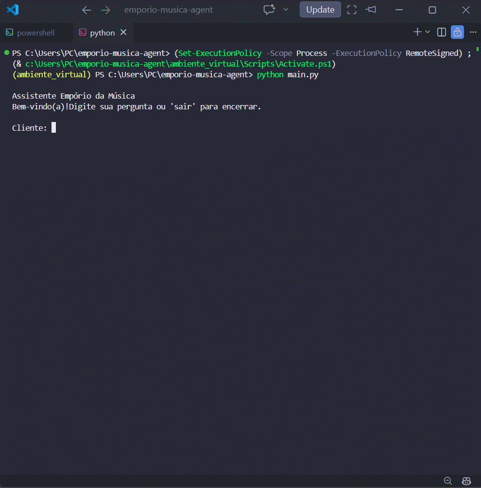
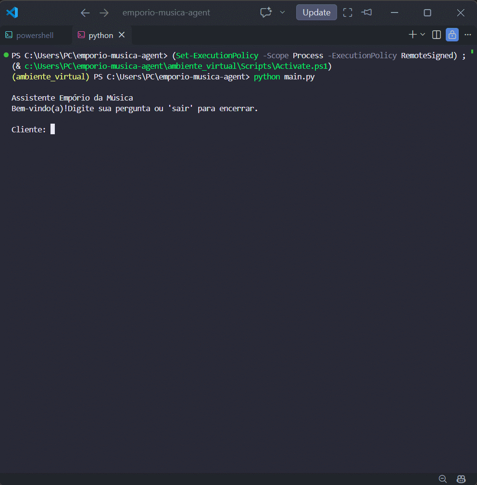
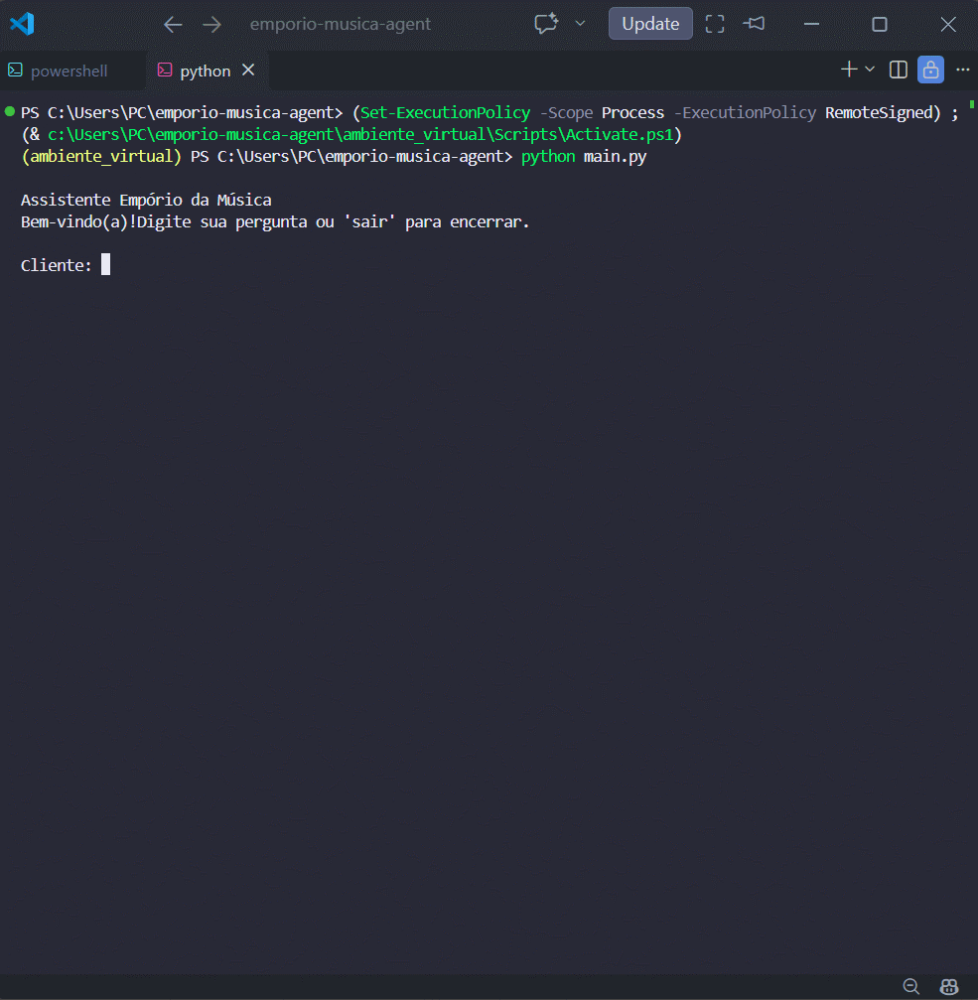

# ♪ Empório da Música - AI Customer Service Agent ♪ 

## Overview

This project implements a customer service agent for the fictional music store **Empório da Música**.

The agent is capable of answering questions about:

- Available products
- Order status
- Active promotions
- Store policies
- Special scenarios such as out-of-stock, discontinued, and pre-order products

The goal of this project is to provide a simple customer service experience by consolidating information distributed across multiple sources and delivering consistent responses according to the business rules defined in the challenge.

---

## Technologies Used

- Python 3.14
- Pandas
- RapidFuzz
- Pytest
- PDF Processing
- CLI (Command Line Interface)

---

## Architecture

To develop the agent, I chose to separate responsibilities according to the domain of the information being queried.

- Product-related questions → answered through the product catalog.
- Order-related questions → answered through the orders database.
- Promotion-related questions → answered through the promotions database.
- Questions regarding returns, exchanges, warranties, and shipping → answered using the store policy manual.

This organization keeps the code simple, facilitates future maintenance, and improves response consistency.

```text
                User
                    │
                    ▼
          AI Customer Service Agent
                    │
      ┌─────────────┼─────────────┐
      ▼             ▼             ▼
 ProductTool   OrderTool   PromotionTool
      │             │             │
 products.csv  orders.csv  promotions.csv

                    │
                    ▼
               PolicyRAG
                    │
                    ▼
        politicas_da_loja.pdf
```

Each component has a clear responsibility, reducing system complexity and facilitating future improvements.

---

## Key Features

- Approximate search using RapidFuzz
- Alternative product suggestions for out-of-stock items
- Discontinued product handling
- Pre-order product handling
- Clear separation of responsibilities by domain
- Automated testing coverage
- Architecture prepared for future LLM integration

---

## Technical Decisions

### Approach

I chose a structured-data-based approach in which each query is routed to the component responsible for the corresponding domain.

For example:

- Product-related questions query the catalog.
- Order-related questions query the orders database.
- Promotion-related questions query the promotions table.
- Policy-related questions use the store policy manual.

This approach was chosen because the challenge data was already well-structured, allowing accurate responses without adding unnecessary complexity to the project.

### Model and Provider

Initially, I considered using a Large Language Model (LLM) to answer customer questions.

After analyzing the challenge requirements and the provided data, I concluded that most queries could be answered directly using CSV files and the store policy manual.

As a result, I opted for a simpler, more transparent solution that can be easily executed by evaluators without requiring:

- API keys
- External provider credits
- Additional configuration

The solution was designed with a modular architecture, allowing future integration of an LLM without significant changes to the data layer.

### User Interface

The project uses a CLI (Command Line Interface).

Motivations:

- Simplicity
- Ease of evaluation
- Focus on business logic
- Minimal infrastructure dependencies

Example:

```text
Customer:
Qual o status do pedido 8?

Assistant:
Seu pedido já foi enviado e está em transporte.
```

### Conversation History

Conversation history persistence was not implemented.

During development, I prioritized the main goals of the challenge:

- Product queries
- Order queries
- Promotion queries
- Policy queries

For the proposed scenarios, queries are independent and do not require conversational context between interactions.

In a production environment, conversation history could be added to support contextual assistance and conversation continuity.

### Data Processing

Structured data is loaded using Pandas.

Validations were implemented for:

- Out-of-stock products
- Discontinued products
- Pre-order products ("coming soon")
- Products outside the company's catalog

RapidFuzz was also used to provide approximate matching and improve the user experience.

Example:

```text
Input:
Takamine GD20

Matched Product:
Takamine GD20 Dreadnought Natural
```

---

## Implemented Functionalities

> **Note:** The example queries below remain in Portuguese because the agent was designed and tested using the original challenge dataset and business rules provided in Portuguese.

### Product Search

Example:

```text
Customer:
Takamine GD20

Response:

Product: Takamine GD20 Dreadnought Natural
Price: R$ 2199.00
Stock: 5
Status: Available
```

### Demo

<p align="center">
  
</p>

---

### Order Lookup

Example:

```text
Customer:
Qual o status do pedido 8?

Response:

Order: 8
Status: Seu pedido já foi enviado e está em transporte.
Tracking Code: BRJL5544332BR
```

### Demo

<p align="center">
  
</p>

---

### Promotions Lookup

Example:

```text
Customer:
Quais promoções estão ativas?

Response:

Product
Original Price
Discount
Promotional Price
```

### Demo

<p align="center">
  
</p>

---

### Store Policy Lookup

Example:

```text
Customer:
Posso devolver um produto?

Response:

Online purchases can be returned within 7 calendar days after delivery.
```

### Demo

<p align="center">
  
</p>
---

### Out-of-Stock Products

When a product has zero stock available, the agent informs the customer and suggests alternatives from the same category.

### Demo

<p align="center">
  
</p>

---

### Discontinued Products

When a product is discontinued, the agent informs the customer and recommends similar alternatives.

### Demo

<p align="center">
  
</p>

---

### Pre-Order Products

Products marked as `coming_soon` receive special handling.

### Demo

<p align="center">
  
</p>

---

### Items Outside the Catalog

The agent recognizes products that are not sold by the store, such as:

- Strings
- Cables
- Pedals
- Cases
- Amplifiers
- Guitar picks

### Demo

<p align="center">
  
</p>

In these cases, the response follows the business rules defined in the store manual.

---

## Project Structure

```text
emporio-musica-agent/
│
├── data/
│   ├── categories.csv
│   ├── customers.csv
│   ├── order_items.csv
│   ├── orders.csv
│   ├── politicas_da_loja.pdf
│   ├── products.csv
│   └── promotions.csv
│
├── examples/
│   └── demos/
│
├── src/
│   ├── data_loader.py
│   ├── rag.py
│   └── tools.py
│
├── tests/
│
├── .gitignore
├── main.py
├── README.md
└── requirements.txt
```

---

## How to Run

Open your Command Prompt or PowerShell and follow these steps:

### 1. Create a virtual environment

```bash
python -m venv ambiente_virtual
```

### 2. Activate the virtual environment

Windows:

```bash
ambiente_virtual\Scripts\activate
```

### 3. Install dependencies

```bash
pip install -r requirements.txt
```

### 4. Run the project

```bash
python main.py
```

---

## Tests

To run the automated tests:

```bash
python -m pytest
```

The test suite validates:

- Product queries
- Approximate matching
- Order lookups
- Promotions
- Store policies

### Current Result

```text
platform win32 -- Python 3.14
collected 7 items

7 passed


## Limitations

- No conversation memory.
- Does not use an LLM to generate responses.
- Policy lookup relies on rule-based retrieval rather than vector embeddings.
- No web interface.

---

## Future Improvements

Given additional development time, I would prioritize:

- LLM integration using Function Calling
- Embedding-based Vector RAG
- LangGraph for agent orchestration
- Web interface
- Conversation memory
- Integration testing
- Docker containerization

---

## AI Assistant Usage

Microsoft Copilot was used during development for:

- Technical clarification
- Architecture discussions
- Documentation review
- Project structure organization
- Implementation support

All architectural decisions, component adaptations, testing, and result validation were performed manually.


## Conclusion

The proposed solution fulfills the challenge requirements through a simple, modular, and maintainable architecture that prioritizes reliability, transparency, and ease of evaluation. In addition to covering all requested scenarios, the project structure was intentionally designed to support future enhancements, including LLM integration, Vector RAG, conversational memory, and more advanced user interfaces.