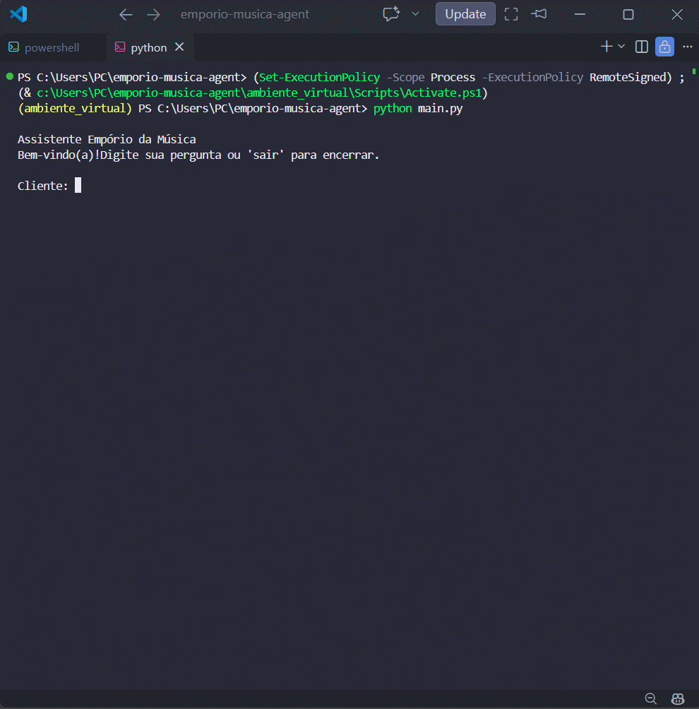
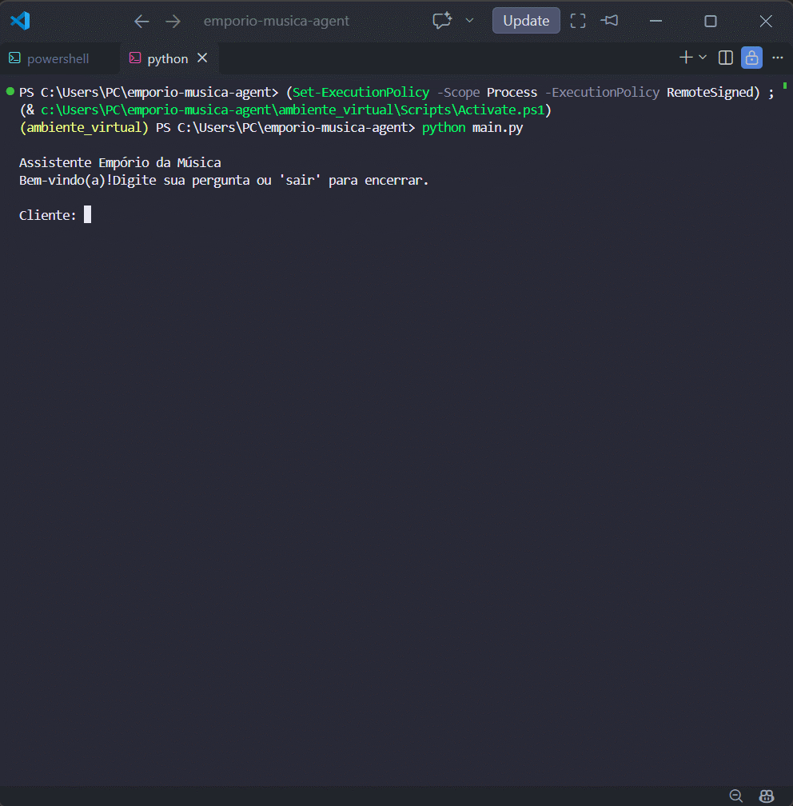
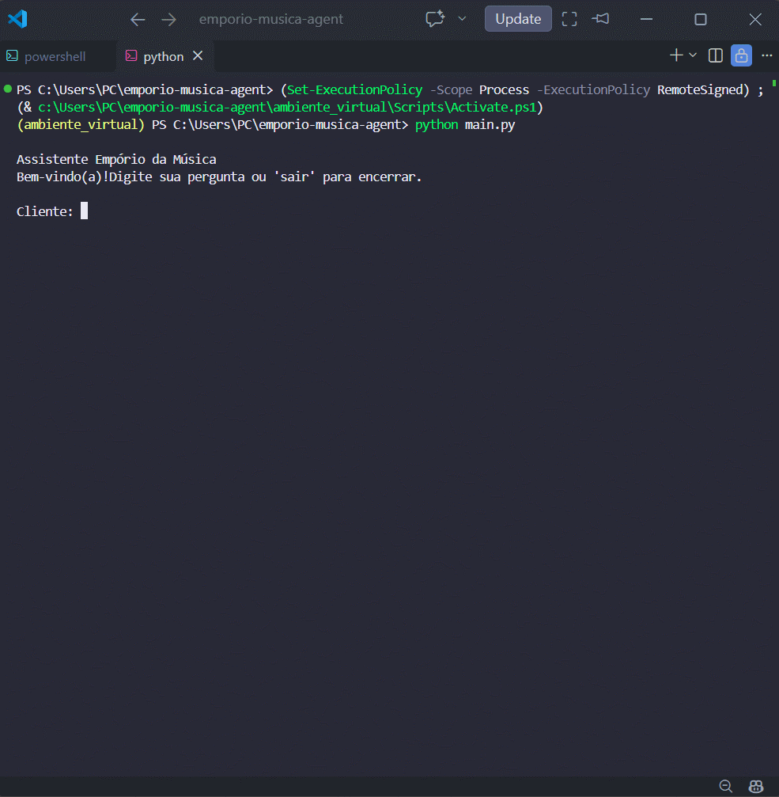

# ♪ Empório da Música - AI Customer Service Agent ♪ 

## Visão Geral

Este projeto implementa um agente de atendimento para a loja fictícia **Empório da Música**.

O agente é capaz de responder perguntas sobre:

- Produtos disponíveis
- Status de pedidos
- Promoções ativas
- Políticas da loja
- Situações especiais, como produtos sem estoque, descontinuados e em pré-venda

O objetivo deste projeto é proporcionar uma experiência simples de atendimento ao cliente, reunindo informações distribuídas em diferentes fontes e fornecendo respostas consistentes de acordo com as regras de negócio definidas no desafio.

---

## Tecnologias Utilizadas

- Python 3.14
- Pandas
- RapidFuzz
- Pytest
- Processamento de PDF
- CLI (Command Line Interface)

---

## Arquitetura

Para desenvolver o agente, optei por separar as responsabilidades de acordo com o domínio da informação consultada.

- Perguntas sobre produtos → respondidas através do catálogo.
- Perguntas sobre pedidos → respondidas através da base de pedidos.
- Perguntas sobre promoções → respondidas através da base de promoções.
- Questões relacionadas a trocas, devoluções, garantia e frete → respondidas utilizando o manual da loja.

Essa organização mantém o código simples, facilita a manutenção futura e melhora a consistência das respostas.

```text
                Usuário
                    │
                    ▼
          AI Customer Service Agent
                    │
      ┌─────────────┼─────────────┐
      ▼             ▼             ▼
 ProductTool   OrderTool   PromotionTool
      │             │             │
 products.csv  orders.csv  promotions.csv

                    │
                    ▼
               PolicyRAG
                    │
                    ▼
        politicas_da_loja.pdf
```

Cada componente possui uma responsabilidade clara, reduzindo a complexidade do sistema e facilitando futuras evoluções.

---

## Diferenciais

- Busca aproximada utilizando RapidFuzz
- Sugestão de alternativas para produtos sem estoque
- Tratamento de produtos descontinuados
- Tratamento de produtos em pré-venda
- Separação clara de responsabilidades por domínio
- Cobertura de testes automatizados
- Estrutura preparada para futura integração com LLM

---

## Decisões Técnicas

### Abordagem

Optei por uma solução baseada em dados estruturados, na qual cada consulta é direcionada ao componente responsável pelo respectivo domínio.

Por exemplo:

- Perguntas sobre produtos consultam o catálogo.
- Perguntas sobre pedidos consultam a base de pedidos.
- Perguntas sobre promoções consultam a tabela de promoções.
- Perguntas sobre políticas utilizam o manual da loja.

Essa abordagem foi escolhida porque os dados fornecidos no desafio já estavam bem estruturados, permitindo respostas precisas sem adicionar complexidade desnecessária ao projeto.

### Modelo e Provedor

Inicialmente considerei utilizar um Large Language Model (LLM) para responder às perguntas dos clientes.

Após analisar os requisitos e os dados fornecidos, concluí que a maior parte das consultas poderia ser respondida diretamente por meio dos arquivos CSV e do manual da loja.

Como resultado, optei por uma solução mais simples, transparente e fácil de executar pelos avaliadores, sem exigir:

- Chaves de API
- Créditos em provedores externos
- Configurações adicionais

A solução foi projetada com uma arquitetura modular, permitindo futura integração com um LLM sem alterações significativas na camada de dados.

### Interface de Interação

O projeto utiliza uma CLI (Command Line Interface).

Motivações:

- Simplicidade
- Facilidade de avaliação
- Foco na lógica de negócio
- Baixa dependência de infraestrutura

Exemplo:

```text
Cliente:
Qual o status do pedido 8?

Assistente:
Seu pedido já foi enviado e está em transporte.
```

### Histórico de Conversas

A persistência de histórico de conversas não foi implementada.

Durante o desenvolvimento, priorizei os principais objetivos do desafio:

- Consulta de produtos
- Consulta de pedidos
- Consulta de promoções
- Consulta de políticas

Para os cenários propostos, as consultas são independentes e não exigem contexto entre interações.

Em um ambiente de produção, a persistência de histórico poderia ser adicionada para suportar atendimento contextual e continuidade da conversa.

### Tratamento dos Dados

Os dados estruturados são carregados utilizando Pandas.

Foram implementadas validações para:

- Produtos sem estoque
- Produtos descontinuados
- Produtos em pré-venda ("coming soon")
- Produtos fora do catálogo da empresa

O RapidFuzz também foi utilizado para fornecer correspondência aproximada e melhorar a experiência do usuário.

Exemplo:

```text
Entrada:
Takamine GD20

Produto Encontrado:
Takamine GD20 Dreadnought Natural
```

---

## Funcionalidades Implementadas

> **Observação:** As consultas de exemplo abaixo permanecem em português, pois o agente foi projetado e testado utilizando o conjunto de dados e as regras de negócio originais do desafio.

### Consulta de Produtos

Exemplo:

```text
Cliente:
Takamine GD20

Resposta:

Produto: Takamine GD20 Dreadnought Natural
Preço: R$ 2199,00
Estoque: 5
Status: Disponível
```

### Demonstração

<p align="center">
  
</p>
---

### Consulta de Pedidos

Exemplo:

```text
Cliente:
Qual o status do pedido 8?

Resposta:

Pedido: 8
Status: Seu pedido já foi enviado e está em transporte.
Código de rastreamento: BRJL5544332BR
```

### Demonstração

<p align="center">
  
</p>

---

### Consulta de Promoções

Exemplo:

```text
Cliente:
Quais promoções estão ativas?

Resposta:

Produto
Preço original
Desconto
Preço promocional
```

### Demonstração

<p align="center">
  
</p>

---

### Consulta de Políticas

Exemplo:

```text
Cliente:
Posso devolver um produto?

Resposta:

Compras online podem ser devolvidas em até 7 dias corridos após o recebimento.
```

### Demonstração

<p align="center">
  
</p>

---

### Produtos Sem Estoque

Quando um produto possui estoque igual a zero, o agente informa a indisponibilidade e sugere alternativas da mesma categoria.

### Demonstração

<p align="center">
  
</p>

---

### Produtos Descontinuados

Quando um produto está descontinuado, o agente informa a situação e recomenda alternativas semelhantes.

### Demonstração

<p align="center">
  
</p>

---

### Produtos em Pré-venda

Produtos marcados como `coming_soon` recebem tratamento específico.

### Demonstração

<p align="center">
  
</p>

---

### Itens Fora do Catálogo

O agente reconhece produtos que não são comercializados pela loja, como:

- Cordas
- Cabos
- Pedais
- Cases
- Amplificadores
- Palhetas

### Demonstração

<p align="center">
  
</p>

Nesses casos, a resposta segue as regras definidas no manual da loja.

---

## Estrutura do Projeto

```text
emporio-musica-agent/
│
├── data/
│   ├── categories.csv
│   ├── customers.csv
│   ├── order_items.csv
│   ├── orders.csv
│   ├── politicas_da_loja.pdf
│   ├── products.csv
│   └── promotions.csv
│
├── examples/
│   └── demos/
│
├── src/
│   ├── data_loader.py
│   ├── rag.py
│   └── tools.py
│
├── tests/
│
├── .gitignore
├── main.py
├── README.md
└── requirements.txt
```

---

## Como Executar

Abra o Prompt de Comando ou PowerShell e siga os passos abaixobash
pip install -r requirements.txt
```

### 4. Executar o projeto

```bash
python main.py
```

---

## Testes

Para executar os testes automatizados:

```bash
python -m pytest
```

Os testes validam:

- Consulta de produtos
- Busca aproximada
- Consulta de pedidos
- Consulta de promoções
- Consulta de políticas

### Resultado Atual

```text
platform win32 -- Python 3.14
collected 7 items

7 passed
```

---

## Limitações

- Não possui memória conversacional.
- Não utiliza LLM para geração de respostas.
- A consulta ao manual utiliza recuperação baseada em regras em vez de embeddings vetoriais.
- Não possui interface web.

---

## O Que Eu Faria Com Mais Tempo

Com mais tempo de desenvolvimento, eu priorizaria:

- Integração com LLM utilizando Function Calling
- RAG Vetorial baseado em embeddings
- LangGraph para orquestração do agente
- Interface web
- Memória conversacional
- Testes de integração
- Containerização com Docker

---

## Uso de Assistente de IA

O Microsoft Copilot foi utilizado durante o desenvolvimento para:

- Esclarecimento de dúvidas técnicas
- Discussão de arquitetura
- Revisão da documentação
- Organização da estrutura do projeto
- Apoio à implementação

Todas as decisões arquiteturais, adaptações dos componentes, testes e validação dos resultados foram realizadas manualmente.

---

## Conclusão

A solução proposta atende aos requisitos do desafio por meio de uma arquitetura simples, modular e de fácil manutenção, priorizando confiabilidade, transparência e facilidade de avaliação.

Além de cobrir todos os cenários solicitados, a estrutura do projeto foi intencionalmente projetada para suportar futuras evoluções, incluindo integração com LLMs, RAG Vetorial, memória conversacional e interfaces mais avançadas.